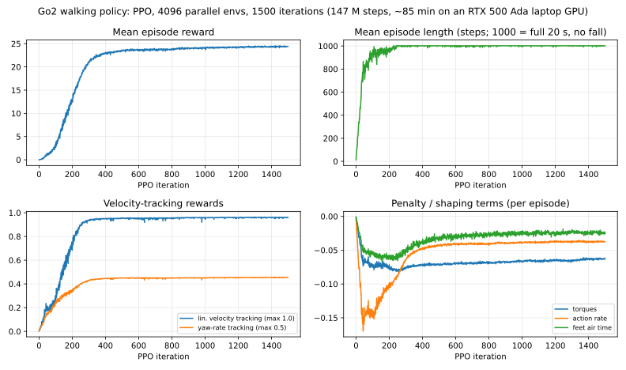

# Unitree Go2: lidar navigation, vision, MuJoCo simulation and reinforcement learning

ENG 6010 project, built on top of Unitree's `unitree_sdk2_python`. (Unitree's own README for the SDK is
[`README.md`](README.md); this file describes the project work.)

The project takes a Unitree Go2 quadruped from "drive it from a keyboard" to a small research platform:
a live lidar + camera operator console, a vision module that tracks moving things with optical flow, a MuJoCo
simulation that real-dog programs can run against unchanged, and a walking policy trained with reinforcement
learning (PPO) and evaluated in that simulation.

**Contents**
1. [Background and motivation](#1-background-and-motivation)
2. [How this work answers the Second Test](#2-how-this-work-answers-the-second-test)
3. [Question 1: vision / ML on the dog (optical flow)](#3-question-1-vision--ml-on-the-dog-optical-flow)
4. [Question 2: dog data and simulation](#4-question-2-dog-data-and-simulation)
5. [Question 3: an RL-based dog task (learned walking)](#5-question-3-an-rl-based-dog-task-learned-walking)
6. [The system underneath (earlier phases)](#6-the-system-underneath-earlier-phases)
7. [Reproducing the results](#7-reproducing-the-results)
8. [Safety](#8-safety)
9. [Status: what was verified where, and known limitations](#9-status-what-was-verified-where-and-known-limitations)
10. [Repository map](#10-repository-map)
11. [References](#11-references)

---

## 1. Background and motivation

A legged robot is only useful if it can **perceive** its surroundings and **move** reliably through them. The Go2
ships with a capable built-in gait ("sport mode") and a 4D lidar, but its software is closed: you send velocity
commands and receive state. That raises three practical questions that this project works on:

* **Perception when the sensors are limited.** Over Wi-Fi the dog does *not* stream the raw lidar (we measured
  this: not one `rt/utlidar/cloud_deskewed` message arrived in 8 s); only a coarse accumulated voxel map comes
  through. The camera is then the only fast sensor, and it can see what lidar maps cannot: things that are
  *moving*. Optical flow is a cheap, training-free way to detect and track motion, which is why it was chosen for
  Question 1.
* **Safe, repeatable development.** Testing navigation, obstacle logic and learned controllers on a real robot is
  slow and can damage it. A simulation that speaks the *same* interface as the dog (same DDS topics, same
  sport-mode RPC) lets us run the real-dog programs against a virtual robot first. That is Question 2.
* **Learned locomotion.** Modern quadruped controllers are trained with reinforcement learning in massively
  parallel simulation and then transferred. We reproduce that pipeline for the Go2, train a walking policy, and
  check it in a *different* physics engine than it was trained in (sim-to-sim). That is Question 3.

Everything is organised around one tool, `lidar_control.py`, an operator console that drives the dog (or the
simulated dog) and shows lidar, camera, depth, optical flow and on-screen mouse buttons in one window.

Work timeline (dates are from the git history and file timestamps):

| Date (2026) | Work |
|---|---|
| Oct 9 | First RL attempt with `unitree_rl_gym`, stopped at 150 iterations (its exported policy collapsed when tried in MuJoCo) |
| Oct 16 | Phase 1 committed: keyboard control, lidar viewer, first versions of waypoint navigation, dodging and pillar scans, first real-dog recordings |
| Oct 16–27 | `lidar_control.py` grown into the full console: 3D / first-person views, camera fusion, persistent point map, obstacle map and waypoint navigation, dodging, pillar scans, Wi-Fi link, depth map |
| Nov 3 | MuJoCo simulation brought up; model-based gait; simulated sport-mode service; PPO training run (1500 iterations); simulated lidar |
| Nov 6 | Obstacle map "3 separate frames" rule; camera-stall fix over Ethernet |
| Nov 10–11 | Optical-flow mover tracking, camera-clip recorder and offline replay, on-screen mouse buttons, this README |

---

## 2. How this work answers the Second Test

This section maps each requirement of the *ENG 6010 Second Test* PDF to what is in this repository, with the file
that shows it and an honest status. "Verified" always says *where* it was verified; see
[section 9](#9-status-what-was-verified-where-and-known-limitations) for the full list.

### Question 1: "Implement Vision/ML for a Dog Task" (choose one or two)

| Requirement | What we did | Where | Status |
|---|---|---|---|
| Choose **one or two** methods and implement them in a dog task | **Optical flow** (main) for tracking moving things from the dog's camera, plus a pretrained **monocular-depth network** (Depth Anything V2) fused with the lidar. Both run inside the dog operator console. | `motion_flow.py`, `lidar_control.py` (`FlowFeed`, `DepthFeed`), `flow_replay.py` | Optical flow: verified on synthetic video and through the full application with a fake dog link; **not yet recorded on the real dog's video**. Depth map: runs live on the camera picture (earlier phase); its lidar consistency filter was checked on synthetic data only (see 3.5). |
| Optical Flow | Dense DIS optical flow, camera-ego-motion fit (RANSAC similarity), residual-motion blobs, 3-frame-confirmed tracker with ids and speeds; three views (movers / colour / arrows); recorder + offline replay for tuning | `motion_flow.py`; keys `3`-`7` in `lidar_control.py` | As above |
| Color Space | Used, but only in a supporting role: RGB to grayscale for the flow, and an HSV encoding (hue = direction, value = speed) for the "flow colour" view | `motion_flow.py` (`_finish`) | Implemented; not a standalone experiment |
| Gaussian Pyramid | OpenCV's DIS flow estimates motion coarse-to-fine over an image pyramid; frames are first shrunk with area averaging. We use this through the library and did **not** write our own pyramid code. | `motion_flow.py` | Used via library only |
| Grab Cut | Not done | n/a | Not attempted |
| Supervised Learning | A *pretrained* supervised depth network is used for inference (no training by us). | `lidar_control.py` (`DepthFeed`, `depth_consistency`) | Inference only; we did not train a supervised model |
| Alternative choices | The depth-plus-lidar consistency filter, and the lidar-based moving-object tracker (`dodge.py`) that optical flow complements | `lidar_control.py`, `dodge.py` | Earlier phase |

### Question 2: "Dog Data and Simulation" (collect data from the dog and do an actual dog simulation; make it more mature)

| Requirement | What we did | Where | Status |
|---|---|---|---|
| **Collect data from the dog** | Lidar recordings and point-cloud snapshots from the real dog (3 recordings, 2 full scans, 2 pillar scans, 1 mesh); a measurement of the dog's video link; a **camera-clip recorder** (key `7`) that saves camera frames with pose, drive commands and flow results for offline use | `captures/`, `lidar_control.py` (`Recorder`, `ClipRecorder`), `lidar_probe.py`, [section 4.1](#41-data-collected-from-the-real-dog) | Lidar data collected on the real dog. **No real camera clip is in the repo yet**; the recorder is tested only with a fake link. |
| Do an **actual dog simulation** | A MuJoCo simulation of the Go2 that speaks the dog's real interface: joint-level DDS topics, a stand-in for the dog's sport-mode service so `SportClient` scripts run unchanged, and a simulated lidar publishing the real lidar topics | `sim/`, `go2_sim_dog.py` | Verified: scripted `SportClient` calls (stand, move, stop, lie down) and the `DdsLink` class that `lidar_control.py` uses (lidar, pose, sport commands) work against the simulated dog, and `lidar_control.py` itself ran against it headless |
| **Make it more mature** | Simulated lidar calibrated against the real recordings; test scenes with obstacles; two interchangeable controllers (model-based gait and the trained RL policy); fix for a DDS large-message problem; an installer that rebuilds the sim from a clean clone | `sim/`, [section 4.3](#43-simulation-vs-the-real-dog) | Verified (numbers in 4.3) |
| References: `unitree_go2_create_dataset`, `unitree_rl_gym` | `unitree_rl_gym` is used (Question 3). Our dataset tooling is our own recorder; the code in this repo does not use the `unitree_go2_create_dataset` repository. | n/a | n/a |

### Question 3: "Implement an RL based Dog Task"

| Requirement | What we did | Where | Status |
|---|---|---|---|
| "See the overall RL components in your code" | Environment, observation, action, reward, policy network, PPO algorithm, training loop, evaluation, and deployment are all present and listed in [section 5.2](#52-rl-components-checklist) | `rl/`, `go2_sim_dog.py`, Unitree's `unitree_rl_gym` (external clone) | Complete |
| Complete the training | **Finished**: PPO, 4096 parallel environments, 1500 iterations (147 M steps) in 85 min. Reward 0.1 to 24.4; mean episode length first reaches 950 of 1000 at iteration 85 and sits near 1000 from about iteration 250 | `rl/training_curves.csv`, `docs/figures/rl_training_curves.svg`, `rl/checkpoints/go2_walk_model_1500.pt` | Verified (training logs) |
| Evaluate the result | The policy is run in MuJoCo, a different physics engine from training (sim-to-sim), at several velocity commands | `rl/eval_in_mujoco.py`, [section 5.4](#54-evaluation-in-mujoco-sim-to-sim) | Verified in simulation; **not deployed on the real dog** |
| "Leverage Google Colab Pro" | Not used. The training fit on a local laptop GPU (RTX 500 Ada, 4 GB) in 85 minutes, so Colab was not needed. | n/a | n/a |

### Deliverable checklist

| Requirement | Where |
|---|---|
| Clear background and motivation | [Section 1](#1-background-and-motivation) |
| Methods and results for each of the 3 questions | Sections [3](#3-question-1-vision--ml-on-the-dog-optical-flow), [4](#4-question-2-dog-data-and-simulation), [5](#5-question-3-an-rl-based-dog-task-learned-walking) |
| Code and data in one repository | Section [10](#10-repository-map) lists every file; data is under `captures/` and `rl/` |
| Detailed README | This file |

---

## 3. Question 1: vision / ML on the dog (optical flow)

### 3.1 Task

Detect and track **things that move by themselves** in the dog's front-camera video, while the dog itself is
walking, turning and leaning. The result is drawn on the live camera picture in `lidar_control.py`.

Why this is hard: when the camera moves, *everything* in the picture moves. A moving person only stands out if the
camera's own motion is removed first.

### 3.2 Method (`motion_flow.py`)

For each camera frame:

1. **Shrink** the frame to 320 px wide (area averaging) and convert to grayscale.
2. **Dense optical flow** (OpenCV DIS, "medium" preset, which works coarse-to-fine over an image pyramid) against
   the newest earlier frame that is at least 0.1 s old. A longer gap gives more motion to measure than two
   back-to-back frames.
3. **Camera ego-motion fit.** A similarity transform (shift + rotation + zoom) is fitted to a grid of flow vectors
   with RANSAC (`cv2.estimateAffinePartial2D`), so a moving object cannot spoil the fit. Walking forward shows up
   as zoom, turning as shift, leaning as rotation.
4. **Residual motion.** Subtract the fitted camera motion from the flow. Pixels whose leftover is larger than a
   threshold (`MOTION`, 1.5 px per 0.1 s at 320 px wide; adjustable live with keys `5`/`6`) are "moving".
   Morphological open/close removes speckle; connected components give blobs; tiny blobs are dropped.
5. **Tracking.** Blobs are linked frame to frame by nearest centre. A blob must be seen in **3 frames** before it
   is shown as a confirmed track (this removes one-frame flickers), keeps an id, a smoothed box and a speed in
   picture-widths per second, and is dropped after 0.6 s unseen.
6. **Safeguards.** If the camera-motion fit explains less than 45% of the picture, or the camera moves too fast
   to trust (turning, blur), no movers are reported and the reason is shown ("camera fit 38%", ...).
7. **Timing.** Frames are timed by when they *arrive*, and all flows are normalised to the same 0.1 s so Wi-Fi
   jitter changes the noise rather than the thresholds. A gap longer than 0.6 s resets the history.

### 3.3 Using it

In `lidar_control.py` (Wi-Fi: `.venv_wifi/bin/python lidar_control.py wifi ap`; cable: `... eth0`):

| Key / button | Action |
|---|---|
| `3` | optical flow on / off (turns the camera on; the picture is shown in first-person view, key `V`) |
| `4` | view: **movers** (red tint, orange boxes with id and speed, white heading line) / **colour** (hue = flow direction) / **arrows** (grey = matches camera motion, red = does not) |
| `5` / `6` | less / more sensitive |
| `7` | record a camera **clip** (JPEG frames + `frames.csv` + `notes.txt` in `captures/clip_<date>/`) |

Every key is also an on-screen mouse button (`F3` shows/hides the button column).

Recorded clips can be replayed offline with different settings, which is how the method is meant to be tuned
on real footage without going back to the robot:

```bash
.venv_wifi/bin/python flow_replay.py captures/clip_<date> --motion 2.5 --view arrows --every 10
```

It prints how often the camera fit was good and how many movers were found, next to what the live view showed,
and writes annotated pictures.

### 3.4 Results

**Speed** (`flow_bench`-style test on synthetic frames with a known shift; this machine, CPU only):

| Method | 640x360 | 320x180 |
|---|---|---|
| DIS ultrafast | 3.1 ms | 0.9 ms |
| DIS medium (**used**) | 22.6 ms | 7.5 ms |
| Lucas-Kanade (200 points) | 2.8 ms | 2.7 ms |
| Farneback | 64.4 ms | 13.6 ms |

The whole pipeline (flow + ego-motion fit + blobs + tracker) takes about **6 ms per frame** at 320 px wide, far
faster than the camera delivers frames, so it never limits the live view.

**Accuracy on synthetic video** (`tests/flow_synthetic_test.py`). The test camera pans, drifts and zooms like a
walking dog, and two textured objects move through the picture by themselves; frames arrive with timing jitter.

| Check | Result |
|---|---|
| Both movers tracked, each with one stable id | pass |
| False tracks with camera motion only (nothing moving) | **0** |
| Measured mover speed vs the true speed (camera motion removed) | median ratio **0.94** |
| Mover position error | median about 38 px on a 1280 px-wide picture (roughly a quarter of the box size) |

Through the whole application (`lidar_control.main()` against a fake dog link, scripted keypresses): the flow
overlay, all three views, the sensitivity keys, the recorder (manual stop, 60 s auto-stop, save on quit) and the
replay tool all ran correctly, and replay agreed with what the live view had shown (camera fit 95%, movers in 91%
of frames vs 94% live).

### 3.5 Second method: monocular depth fused with lidar (earlier phase)

`DepthFeed` runs **Depth Anything V2 Small**, a pretrained supervised depth network, on the camera picture
(about 10 maps/s on the laptop GPU; the map itself has been run live on the dog's video). Its output is *relative* depth, so `depth_consistency()` fits
`depth = a / range + b` robustly (iterated, MAD-based) to the lidar points the camera can see and rejects lidar
points far off that line (ghost points from reflections). On a synthetic test, 100% of injected ghost points were
removed, 99% of good points kept, 0.8 ms per frame. The filter has **not** been validated with the real depth
model and real lidar together on the dog, and the filter can be switched off (key `2`). We did not train any network.

### 3.6 Limitations (please read)

* **Real-dog video has not been tested.** Everything above is synthetic video plus a fake link. The next step is
  to record clips on the dog (key `7`) and tune with `flow_replay.py`; results will be added here.
* One shift/rotation/zoom for the whole picture is an approximation. While the dog walks forward, near static
  objects move differently from far ones and can be flagged as moving; the fit-quality safeguard reduces but does
  not remove this.
* Two movers that overlap merge into one blob; speeds are in picture-widths per second, not metres.
* Sensitivity changes are not saved between runs.

---

## 4. Question 2: dog data and simulation

### 4.1 Data collected from the real dog

All data is in [`captures/`](captures/). Lidar frames are `N x 4` float32 arrays (x, y, z, intensity) in the
dog's odometry frame; `poses.csv` gives the dog's pose per frame.

| Item | Date | Content |
|---|---|---|
| `rec_20261016_184634/` | Oct 16 | 19 lidar frames over 1.2 s (cable, `rt/utlidar/cloud_deskewed`), 1,320-1,690 points per frame, with poses |
| `rec_20261026_113931/` | Oct 26 | 8 frames over 0.9 s, about 27,000 points per frame (denser cloud), with poses |
| `rec_20261026_113938/` | Oct 26 | 95 frames over 12.2 s, about 30,000-36,000 points per frame, with poses (50 MB) |
| `scan_20261016_194335.ply`, `scan_20261020_202610.ply` | Oct 16, 20 | full accumulated scans (20 MB, 15 MB) |
| `pillar_20261016_194337.ply`, `pillar_20261020_202612.ply` | Oct 16, 20 | a pillar extracted from a scan (pillar-orbit tool) |
| `mesh_20261026_120920.ply` | Oct 26 | coloured block mesh of the map |

Measurements made on the dog that shaped the code (from the project notes):

* Motion mode is `mcf`. The lean command (`Euler`) does nothing unless `Pose(True)` is sent first and is
  re-sent at about 10 Hz; leaning while walking made the dog jitter, so leaning is limited to standing still.
* The lidar is a hemisphere pointing about 18 degrees off straight down, so it sees up to about 18 degrees above
  horizontal, straight ahead. 75-88% of each frame is floor. The cloud is about 12 Hz.
* The floor reads at odom z of about -0.05 to -0.10 while the pose height is about 0.31, so floor height is
  *measured* from the points instead of assumed.
* **Video link over Ethernet** (`lidar_control` camera feed): reading the camera 10 times a second, replies were
  lost in about 1% of calls with the camera alone and 5-8% while the lidar also streamed, always in pairs,
  regardless of poll rate; a good call takes 10-45 ms and each frame is about 172 KB. The old code waited 3 s per
  lost reply (up to a 6 s freeze) and had no error handling. Waiting 0.2 s and catching errors
  (`transport.py`: `CAMERA_TIMEOUT`, `CAMERA_POLL`) cut the worst freeze to **0.54 s** with the lidar streaming.
  Lost replies themselves are not fixed (cause not identified).

### 4.2 Simulation

```
  keyboard_control.py / lidar_control.py        (the same scripts that drive the real dog;
        |  SportClient, DDS domain 0, interface "lo")        only the interface name differs)
        v
  go2_sim_dog.py     stand-in for the dog's onboard "sport" + "motion_switcher" services
        |            backend A: learned walking policy      backend B: model-based trot gait
        |  rt/lowcmd  (joint targets, 200 Hz)        ^  rt/lowstate, rt/sportmodestate
        v                                            |
  unitree_mujoco     MuJoCo physics + viewer  +  sim/sim_lidar.py  ->  rt/utlidar/cloud_deskewed,
                                                                       rt/utlidar/robot_pose
```

Pieces:

* **MuJoCo sim** (`unitree_mujoco`, Unitree's own repository, with our changes in [`sim/`](sim/)). Joint-level only:
  it publishes `rt/lowstate` / `rt/sportmodestate` and listens to `rt/lowcmd`. Install our changes into a clone
  with `sim/install_into_unitree_mujoco.sh` (tested against a clean clone at commit `1eb6642`).
* **`go2_sim_dog.py`**: the real dog has an onboard controller that answers `StandUp`, `Move`, `StopMove`, ...;
  the simulator does not. This program answers the same RPC services, so `SportClient` code runs unchanged, and
  turns `Move(vx, vy, vyaw)` into joint targets with either backend. It refuses to run on any network interface
  other than loopback (`lo`), because it publishes raw joint commands.
* **Model-based gait** (`go2_trot.py`): a hand-written trot using two-link leg inverse kinematics and a swing /
  stance foot trajectory, with IMU heading hold. It needs no training and walks at about 0.7 of the commanded speed.
  It is the baseline and fallback for the learned policy.
* **Simulated lidar** (`sim/sim_lidar.py`): casts rays from the Go2's lidar mount (from the URDF: 0.289 m forward,
  0.047 m below the body centre, pitched 2.878 rad so the dome points about 15 degrees forward of straight down),
  hits only world geometry (never the dog's own body), and publishes the same topics as the real dog:
  `rt/utlidar/cloud_deskewed` (about 11.7 Hz, about 1,670 points per frame, odom frame),
  `rt/utlidar/robot_pose` (about 19 Hz), plus the `rt/utlidar/switch` ON/OFF topic.
* **Scenes** (`sim/scene_*.xml`): flat ground; flat ground with pillars, boxes, a ledge and walls
  (`scene_obstacles.xml`, the default) so the lidar has something to see.
* **DDS large-message fix.** On this WSL2 setup, DDS messages above about 11 KB sent over the loopback interface
  never arrive (small topics worked, lidar frames of about 27 KB vanished). Capping the sender's `MaxMessageSize`
  to 1,400 bytes (`sim_lidar.cap_dds_message_size`) fixes it with no change needed on the receiving side.
* A scripted demo (`sim/demo_loop.py`) stands the dog up and walks a small loop through the same API.

### 4.3 Simulation vs the real dog

| Quantity | Real dog (recordings) | Simulation |
|---|---|---|
| Lidar topic | `rt/utlidar/cloud_deskewed` | same topic and message type |
| Frame rate | about 12 Hz | 11.7 Hz |
| Points per frame | 1,320-1,690 (cable recording) | about 1,670 |
| Share of points on the floor | 75-88% | about 90% |
| Frame / coordinate system | odom frame, floor slightly below zero | odom = world, floor at 0 |
| Command interface | `SportClient` (`Move`, `StandUp`, ...) | same calls, answered by `go2_sim_dog.py` |
| Camera / video service | yes | **not simulated** |

Differences to keep in mind: the simulated lidar is an approximation tuned to those numbers, not a model of the
real sensor's scan pattern or noise; the camera is not simulated, so the optical-flow and depth features cannot
run in the simulation; and the sim's walking is a policy or gait, not Unitree's controller.

### 4.4 Real data used on algorithms

The recorded real frames are used offline: the obstacle map's rule that a 10 cm cell becomes an obstacle only after
**three separate lidar frames** hit it (`navigation.py`) was evaluated by replaying the real recordings through the
old and the new rule. On the dense recording the final maps were nearly identical (745 vs 746 cells), with
obstacles appearing two frames later; on the sparse cable recording the new rule produced about 11% fewer cells
(231 vs 259 at frame 18), filtering out one- and two-hit speckle, and obstacles took 5-10 frames to appear.
`tests/obstacle_map_test.py` checks the rule's six cases.

---

## 5. Question 3: an RL-based dog task (learned walking)

### 5.1 Task

Learn a policy that makes the Go2 **walk at commanded velocities** (forward/back, sideways, turning) from joint
and IMU measurements, trained entirely in simulation, then check it in an independent physics engine.

### 5.2 RL components checklist

| Component | Implementation in this project |
|---|---|
| **Framework** | Unitree's [`unitree_rl_gym`](https://github.com/unitreerobotics/unitree_rl_gym) (legged_gym / Isaac Gym Preview 4, `rsl_rl` 1.0.2, PyTorch 2.3.1). Its `go2` task is used **unmodified**, on a flat plane. |
| **Environment** | 4096 parallel Go2 simulations on the GPU; 200 Hz physics, policy at 50 Hz (decimation 4); 20 s episodes; episode ends if the base touches the ground |
| **Observation (48)** | base linear velocity x2 (3), base angular velocity x0.25 (3), projected gravity (3), velocity command x(2, 2, 0.25) (3), joint positions minus default (12), joint velocities x0.05 (12), previous action (12). Sensor noise is added during training. |
| **Action (12)** | joint-position offsets x0.25 rad around the standing pose; PD control with kp = 20, kd = 0.5 |
| **Reward** | linear-velocity tracking (+1.0), yaw-rate tracking (+0.5), feet air time (+1.0); penalties: vertical velocity (-2), roll/pitch rate (-0.05), joint acceleration (-2.5e-7), action rate (-0.01), torques (-2e-4), joint limits (-10), collisions (-1); tracking reward = exp(-error^2 / 0.25) |
| **Domain randomisation** | ground friction 0.5-1.25; random pushes of up to 1 m/s every 15 s; commands resampled every 10 s (vx, vy in [-1, 1] m/s, yaw rate in [-1, 1] rad/s; yaw uses a heading command) |
| **Policy / value network** | MLPs 512-256-128 with ELU, separate actor and critic; initial action noise 1.0, which the training reduced to 0.30 |
| **Algorithm** | PPO: clip 0.2, 5 epochs x 4 mini-batches per iteration, gamma 0.99, lambda 0.95, adaptive learning rate (start 1e-3, target KL 0.01), entropy bonus 0.01, 24 steps per environment per iteration |
| **Training run** | 1500 iterations x (4096 envs x 24 steps) = **147.5 M steps in 85 minutes** (median about 29,500 steps/s) on an RTX 500 Ada laptop GPU. Launcher: `rl/train_go2.sh` |
| **Evaluation** | `rl/eval_in_mujoco.py`: sim-to-sim in MuJoCo at several velocity commands, plus a search over the 24 possible leg orderings |
| **Deployment path** | `go2_sim_dog.py` (`Policy` class) loads the checkpoint, builds the same 48-value observation from `rt/lowstate` and `rt/sportmodestate`, and publishes joint targets on `rt/lowcmd` |

Our contribution here is the training run and its configuration, the evaluation, and the deployment into the
MuJoCo simulation with the `SportClient` interface. The learning algorithm and the Go2 task are Unitree's reference
implementation.

### 5.3 Training results



Data: [`rl/training_curves.csv`](rl/training_curves.csv) (one row per iteration, 19 curves). Final checkpoint:
[`rl/checkpoints/go2_walk_model_1500.pt`](rl/checkpoints/go2_walk_model_1500.pt) (4.6 MB, actor and critic).

| Iteration | Mean reward | Episode length (1000 = no fall) | Linear-velocity tracking (max 1.0) | Yaw-rate tracking (max 0.5) |
|---|---|---|---|---|
| 10 | 0.11 | 211 | 0.04 | 0.03 |
| 100 | 2.64 | 933 | 0.25 | 0.24 |
| 300 | 21.2 | 995 | 0.94 | 0.43 |
| 1000 | 24.0 | 1000 | 0.96 | 0.45 |
| 1499 | **24.4** | 1002 | **0.96** | **0.46** |

Mean episode length first reaches 950 (of 1000) at iteration 85 and stays near 1000 from about iteration 250; the reward passes 20 at iteration 277 and plateaus after about 600. The earlier
October attempt (stopped at 150 iterations) did not yet walk: in MuJoCo it collapsed.

### 5.4 Evaluation in MuJoCo (sim-to-sim)

The policy was trained in PhysX (Isaac Gym) but is evaluated in MuJoCo, a different physics engine with a
different contact model and actuator model, which makes this a real transfer test. `rl/eval_in_mujoco.py`, flat
ground, 10 s per command, `go2_walk_model_1500.pt`:

| Command (vx, vy, vyaw) | Outcome | Achieved |
|---|---|---|
| (0, 0, 0) | stands | drifts 0.02 m |
| (0.3, 0, 0) m/s | walks | 0.27 m/s |
| (0.8, 0, 0) m/s | walks | 0.74 m/s |
| (1.0, 0, 0) m/s | walks | 0.87 m/s (curves 2 m sideways over 8.75 m) |
| (-0.4, 0, 0) m/s | walks backward | -0.33 m/s |
| (0, 0.4, 0) m/s | sidesteps | 0.34 m/s |
| (0, 0, 0.8) rad/s | turns in place | 0.58 rad/s (72%) |
| (0.4, 0, 0.6) | walks a circle | yaw rate 0.51 rad/s (85%) |

None of the eight rollouts fell. Forward speed is tracked at 87-93% of the command, sideways at 85%, backward
at 83%. Through the full DDS path (`go2_sim_dog.py --backend rl`, driven by a `SportClient` script), a 0.6 m/s
command gave 0.55 m/s over 5.3 m, within about 0.25 m of a straight line, and stopped cleanly on `StopMove`.

**Joint-order check.** The policy was trained with legs ordered FL, FR, RL, RR but the SDK and MuJoCo use FR, FL,
RR, RL. Trying all 24 assignments, the expected one (`1,0,3,2`) walked 3.75 m in 8 s; the next best managed 1.61 m.
So the mapping is confirmed by experiment, not assumed.

**Weakness: turning.** Training reports yaw-rate tracking at 91% of its maximum reward, but in MuJoCo the
steady-state turn is about 72% of the command, and *short* turns lose more: a 2 s turn at 0.8 rad/s through the
DDS demo rotated the dog only about 40-45 degrees (about half of the 92 degrees commanded) because the policy
needs time to start turning. The gap between training and MuJoCo is a sim-to-sim difference we have not yet closed.
Possible remedies are a larger yaw weight or yaw range in training, or domain randomisation of actuator strength.

### 5.5 What was not done

* The policy was **not deployed on the real dog**. The real dog's own controller would have to be switched off
  and the policy would drive the joints directly; a bad transfer can hurt the robot, so this was deliberately
  postponed. All RL evidence is in simulation.
* Training used flat ground only (no rough terrain), and Colab was not needed.
* One training run and one seed; no ablation of reward terms.
* A vertical-jump task (trained in place, landing softly) was discussed as a next step but not started.

---

## 6. The system underneath (earlier phases)

`lidar_control.py` (about 2,400 lines, `pygame`) is the operator console that ties everything together. It runs
against the real dog over the Ethernet cable (CycloneDDS) or over Wi-Fi (WebRTC, like the phone app), and against
the simulation. The transport is isolated in `transport.py` (`DdsLink`, `WifiLink`) so the console code is the
same for all three.

| Feature | Module | Notes |
|---|---|---|
| Views: top-down, 3D orbit, first-person; colour by height / distance / camera | `lidar_control.py` | key `V`, `H` |
| Persistent 3 cm point map; a point is removed only when lidar beams repeatedly pass through it | `LidarFeed` | |
| Lidar points projected onto the camera picture; one camera-mount model drives both overlay and first-person view | `CameraMount` | settings saved in `camera_mount.json` |
| Obstacle map (10 cm cells, 3-frame rule), A* waypoint navigation, replanning, stop box | `navigation.py` | `Enter` walks the waypoints |
| Moving-object tracker and dodging (lidar-based) | `dodge.py` | `B` |
| Pillar picking, circling a pillar with tilt scans to build a 3D scan | `pillar_orbit.py` | `C`, `Z`, `X` |
| Depth map and depth-consistency lidar filter | `DepthFeed` | keys `1`, `2` (Section 3.5) |
| Optical-flow mover tracking | `motion_flow.py`, `FlowFeed` | keys `3`-`6` (Section 3) |
| Camera-clip recorder + offline replay | `ClipRecorder`, `flow_replay.py` | key `7` |
| 66 on-screen mouse buttons: every key as a button; hold-to-drive, latch, double-click quit | `onscreen_buttons.py` | `F3` |
| Wi-Fi link (needs the dog's AES key, kept out of git) | `transport.py` | `wifi ap` |

Wi-Fi notes: over Wi-Fi the dog sends the lidar as a compressed voxel map instead of raw frames, and only one
Wi-Fi client is accepted at a time (close the Unitree phone app first). A SLAM-cloud route was tried and did not
work; it is left in `transport.py` but should not be used (it overwrites the dog's saved map).

---

## 7. Reproducing the results

Four separate environments (the Wi-Fi library, CycloneDDS, MuJoCo and Isaac Gym do not share one):

| Environment | Used for | Main contents |
|---|---|---|
| `.venv` | real dog over the cable | `unitree_sdk2py` (this repo, editable), `cyclonedds`, `pygame`, `numpy`, `opencv` |
| `.venv_wifi` | real dog over Wi-Fi, optical flow, depth | `unitree_webrtc_connect`, `pygame`, `numpy`, `opencv-python-headless`, `torch` + `transformers` (depth) |
| `.venv_sim` | the MuJoCo sim, evaluation, plots | `mujoco`, `pygame`, `numpy`, `cyclonedds==0.10.2`, `opencv-python-headless`, CPU `torch`, `matplotlib`, `unitree_sdk2py` (editable) |
| conda env `unitree-rl` (Python 3.8) | RL training | Isaac Gym Preview 4, `rsl_rl`, `torch 2.3.1`, the `unitree_rl_gym` clone |

Creating the simulation environment:

```bash
uv venv --python 3.10 .venv_sim                           # inside the repo folder
uv pip install --python .venv_sim/bin/python mujoco pygame numpy cyclonedds==0.10.2 opencv-python-headless matplotlib -e .
uv pip install --python .venv_sim/bin/python torch --index-url https://download.pytorch.org/whl/cpu
git clone https://github.com/unitreerobotics/unitree_mujoco ../unitree_mujoco && git -C ../unitree_mujoco checkout 1eb6642
sim/install_into_unitree_mujoco.sh ../unitree_mujoco        # our patch, sim_lidar.py and the scenes
export UNITREE_MUJOCO=$PWD/../unitree_mujoco VENV_SIM=$PWD/.venv_sim     # where sim/run_sim.sh and rl/eval_in_mujoco.py look
```

Running the simulation with the trained policy, in three terminals (with the two variables above exported in each):

```bash
sim/run_sim.sh                                                        # 1. MuJoCo window  (SIM_CPU=1 to render on the CPU)
.venv_sim/bin/python go2_sim_dog.py --backend rl                      # 2. the stand-in controller (or --backend gait)
.venv_sim/bin/python lidar_control.py lo                              # 3. the operator console (or keyboard_control.py lo, sim/demo_loop.py)
```

Training and evaluating the walking policy:

```bash
rl/train_go2.sh 1500 walk                                                       # about 85 min on an RTX 500 Ada
python rl/export_tensorboard.py <run folder> rl/training_curves.csv             # unitree-rl env (has tensorboard)
.venv_sim/bin/python rl/make_training_curves.py                                 # regenerates docs/figures/rl_training_curves.svg
.venv_sim/bin/python rl/eval_in_mujoco.py rl/checkpoints/go2_walk_model_1500.pt --commands --scan-legs
```

Tests:

```bash
.venv_wifi/bin/python tests/flow_synthetic_test.py       # optical-flow tracker on synthetic video
.venv/bin/python tests/obstacle_map_test.py              # the 3-separate-frames obstacle rule
```

The real dog (the same console, different interface argument):

```bash
.venv/bin/python lidar_control.py eth0                   # cable
.venv_wifi/bin/python lidar_control.py wifi ap           # Wi-Fi, on the dog's own hotspot
```

---

## 8. Safety

* **The two programs that send raw joint commands (`go2_sim_dog.py`, `go2_trot.py`) are simulation-only.** They
  refuse to start on any interface except `lo`. Raw joint commands on a real Go2 fight its own controller.
* The learned policy has **not** been run on the real dog and should not be without a separate safety plan
  (harness, damping on the remote, joint-limit checks).
* On the real dog use the staged approach: read-only first, then stand, then slow manual driving, then short
  autonomous moves in a cleared room with the remote in hand. `JUMP` and `POUNCE` throw the dog forward and need
  about 2 m of clear space; they ask for a second click or typing.
* The Wi-Fi AES key (`.go2_aes_key`) is a secret and is git-ignored.

---

## 9. Status: what was verified where, and known limitations

| Feature | Verified | Not verified |
|---|---|---|
| Lidar console: cable and Wi-Fi connection, views, driving, point map, pillar scans | used on the real dog (earlier phases; the pillar and scan files in `captures/` came from it) | long-term drift of the map |
| Camera colouring and block mesh, terminal tricks, depth filter, waypoint navigation, dodging | synthetic tests and replays of real recordings | a recorded live run on the dog |
| Camera stall fix (Ethernet) | **measured on the real dog** (before/after numbers in 4.1) | cause of the lost replies |
| 3-frame obstacle rule | unit test + replay of **real recordings** | live on the dog; Wi-Fi voxel-map frame rate unknown |
| Optical flow | synthetic video, through the full app with a fake link | **real camera video** |
| Clip recorder + replay | fake link, synthetic video | a real clip |
| On-screen buttons | headless with a simulated mouse (tap, hold, release, latch, double-click quit) | a real mouse on a real window |
| MuJoCo simulation, simulated lidar, sport stand-in | numerically (rates, point counts, geometry) and by driving it with `SportClient` / `DdsLink` code | the on-screen appearance (the automated checks run headless) |
| RL training | training logs and curves | other seeds / terrains |
| RL policy in MuJoCo | 8 velocity commands, leg-order scan, full DDS path | **the real dog**; turning accuracy is below the command (5.4) |
| Depth map + lidar filter | synthetic ghost-point test | real depth model with real lidar |

Known limitations are listed in each section. The most important: **no result in the vision question is from the
real dog's camera yet, and the RL policy exists only in simulation.**

---

## 10. Repository map

New or changed in this project (everything else is Unitree's SDK):

| Path | What it is |
|---|---|
| `lidar_control.py` | the operator console (lidar, camera, depth, flow, mouse buttons, navigation) |
| `motion_flow.py` | optical-flow ego-motion removal and mover tracker (no pygame; testable alone) |
| `flow_replay.py` | replay a recorded camera clip through `motion_flow` offline |
| `onscreen_buttons.py` | the clickable button column |
| `transport.py` | cable (DDS) and Wi-Fi (WebRTC) links to the dog |
| `navigation.py`, `dodge.py`, `pillar_orbit.py` | obstacle map and A* navigation; moving-object dodging; pillar scans |
| `keyboard_control.py`, `check_dog.py`, `lidar_probe.py` | simple keyboard driver; lowstate check; read-only lidar-topic probe |
| `go2_sim_dog.py` | simulated sport-mode service with the RL-policy and gait backends |
| `go2_trot.py` | model-based trot gait (simulation only) |
| `sim/` | our changes to `unitree_mujoco`: `sim_lidar.py`, scenes, patch, installer, `run_sim.sh`, `demo_loop.py` |
| `rl/` | `train_go2.sh`, `eval_in_mujoco.py`, TensorBoard export and plot scripts, `training_curves.csv`, `checkpoints/go2_walk_model_1500.pt` |
| `docs/figures/rl_training_curves.svg` | training-curve figure |
| `tests/` | `flow_synthetic_test.py`, `obstacle_map_test.py` |
| `captures/` | data recorded from the real dog (Section 4.1) |
| `camera_mount.json` | saved camera-mount calibration |

Not part of the repository: `go2-robot-dog/` (a third-party reference clone used while building the Wi-Fi link),
the virtual environments, `.go2_aes_key`, and the external clones `unitree_mujoco` and `unitree_rl_gym`
(referenced above; our changes to them are in `sim/` and `rl/`).

---

## 11. References

* Unitree Robotics, `unitree_sdk2_python`, `unitree_mujoco`, `unitree_rl_gym`:
  <https://github.com/unitreerobotics>
* N. Rudin, D. Hoeller, P. Reist, M. Hutter. *Learning to Walk in Minutes Using Massively Parallel Deep
  Reinforcement Learning.* CoRL 2021 (the legged_gym method that `unitree_rl_gym` builds on).
* J. Schulman, F. Wolski, P. Dhariwal, A. Radford, O. Klimov. *Proximal Policy Optimization Algorithms.* 2017.
* T. Kroeger, R. Timofte, D. Dai, L. Van Gool. *Fast Optical Flow using Dense Inverse Search.* ECCV 2016 (the DIS
  flow in OpenCV that `motion_flow.py` uses).
* L. Yang et al. *Depth Anything V2.* NeurIPS 2024 (the depth model used in Section 3.5).
* E. Todorov, T. Erez, Y. Tassa. *MuJoCo: A physics engine for model-based control.* IROS 2012.
* Harry He's `go2-robot-dog` (an ENGR 6010 first-test submission): reference for the Go2 Wi-Fi/WebRTC route.
